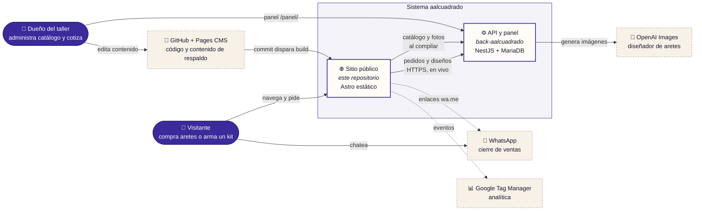
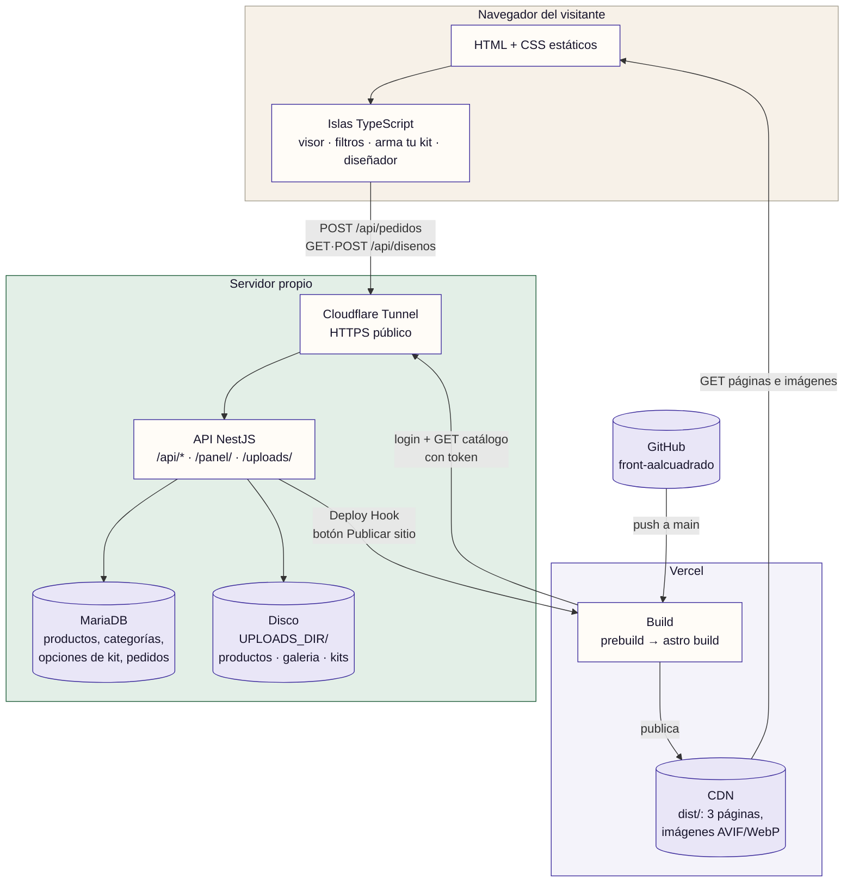
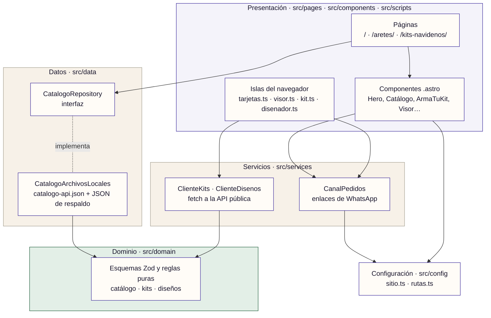
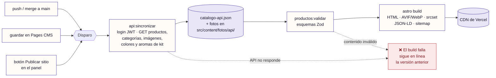
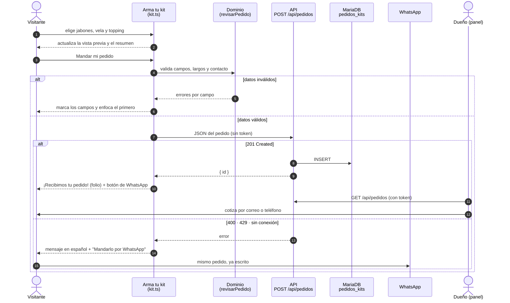
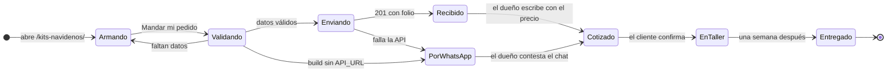
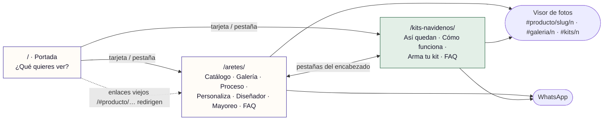

# aalcuadrado · front

Sitio público de **aalcuadrado** (se lee "A al cuadrado"), un taller de manualidades hechas a mano en Mérida. Este repositorio es la **capa de presentación** de un sistema de dos piezas: un sitio estático que se publica en un CDN y una API propia ([back-aalcuadrado](https://github.com/AIMtonio/back-aalcuadrado)) que administra el catálogo y recibe pedidos.

| | |
| --- | --- |
| **Producción** | <https://aalcuadrado.antonioalonso.com.mx> |
| **Estilo** | Sitio estático generado al compilar (SSG), con islas de TypeScript en el navegador |
| **Stack** | Astro 7 · TypeScript estricto · Zod · Sharp · CSS propio (sin frameworks de UI) |
| **Hospedaje** | Vercel (CDN) · la API vive en un servidor propio detrás de Cloudflare Tunnel |
| **Líneas de producto** | Aretes impresos en 3D (catálogo) · Kits navideños de vela + jabones (pedido a la medida) |

> ¿Buscas cómo agregar un producto, cambiar un precio o publicar? Eso está en el **[Manual de operación](docs/operacion.md)**. Este README describe el sistema.

---

## Contenido

1. [Principios](#1-principios)
2. [Contexto del sistema](#2-contexto-del-sistema)
3. [Contenedores y despliegue](#3-contenedores-y-despliegue)
4. [Arquitectura del front](#4-arquitectura-del-front)
5. [Flujo de publicación](#5-flujo-de-publicación)
6. [Flujo de un pedido de kit](#6-flujo-de-un-pedido-de-kit)
7. [Mapa del sitio](#7-mapa-del-sitio)
8. [Atributos de calidad](#8-atributos-de-calidad)
9. [Decisiones de arquitectura](#9-decisiones-de-arquitectura)
10. [Riesgos y deuda técnica](#10-riesgos-y-deuda-técnica)
11. [Desarrollo](#11-desarrollo)
12. [Documentación](#12-documentación)

---

## 1. Principios

1. **Estático primero.** Todo lo que se puede decidir al compilar se decide al compilar: catálogo, fotos optimizadas, opciones de los kits. El navegador solo llama a la API para lo que de verdad ocurre en vivo (mandar un pedido, generar un diseño).
2. **El sitio no se cae si la API se cae.** La API alimenta el *build*, no las visitas. Si está apagada, el sitio publicado sigue funcionando y los pedidos se desvían a WhatsApp.
3. **Un contrato, dos lados.** Los esquemas Zod de `src/domain/` repiten las reglas de los DTO del back. El front valida antes de mandar y el back valida al recibir.
4. **Puertos y adaptadores ligeros.** Páginas y componentes hablan con interfaces (`CatalogoRepository`, `CanalPedidos`), nunca con archivos, `fetch` o WhatsApp directamente.
5. **Configuración de negocio en un solo lugar.** Lo que cambia seguido (precios, textos, tiempos de entrega, opciones fijas) vive en `src/config/sitio.ts`. Lo que cambia muy seguido (productos, colores, aromas, fotos) vive en el panel de la API.

---

## 2. Contexto del sistema

Quién usa el sistema y con qué sistemas externos habla.



| Actor / sistema | Rol |
| --- | --- |
| Visitante | Ve el catálogo de aretes, arma kits navideños y pide por WhatsApp o por formulario. |
| Dueño del taller | Administra productos, categorías, colores, aromas y fotos en el panel; cotiza los pedidos de kits. |
| WhatsApp | Canal de venta principal (aretes) y respaldo de los pedidos de kits. |
| OpenAI Images | Lo usa solo la API, para el diseñador de aretes. La llave nunca llega al navegador. |
| GitHub + Pages CMS | Código fuente y un catálogo de respaldo en JSON, editable desde el navegador. |

---

## 3. Contenedores y despliegue

Dónde corre cada pieza y cómo se comunican.



| Contenedor | Tecnología | Responsabilidad | Escala / costo |
| --- | --- | --- | --- |
| Sitio estático | Astro, HTML, CSS, TS | Presentar el catálogo y los kits; validar y mandar pedidos | CDN global, plan gratuito |
| Build | Node 22+, `scripts/*.mjs`, Sharp | Sincronizar la API, validar contenido y optimizar imágenes | 1 build por cambio, segundos |
| API | NestJS, TypeORM, JWT | Catálogo, fotos, opciones de kit, pedidos, diseñador | Una instancia, límites por IP |
| Base de datos | MariaDB / MySQL | Estado del negocio | Una instancia |
| Archivos | Disco del servidor | Fotos originales subidas desde el panel | Se copian al front en cada build |

---

## 4. Arquitectura del front

Capas dentro de este repositorio. Las flechas indican dependencia: una capa solo conoce a las de abajo.



| Capa | Regla |
| --- | --- |
| Dominio | Solo depende de `zod`. Funciona igual en el navegador, en el build y en los scripts de Node. |
| Datos | Es el único lugar que lee archivos (`import.meta.glob`). Cambiar de origen de datos es cambiar una línea en `src/data/index.ts`. |
| Servicios | Sin APIs de Astro: se usan en el servidor y en el navegador. La UI pide "un enlace para pedir", no "un enlace de WhatsApp". |
| Presentación | Componentes `.astro` sin frameworks de UI. El JavaScript del navegador se carga solo donde hay interacción. |

---

## 5. Flujo de publicación

El catálogo se "congela" en cada build. Cambiar algo en el panel no se ve hasta volver a publicar.



- **Tolerante a versiones de la API.** Si una ruta nueva todavía no existe (responde `404`, por ejemplo `/api/categorias` o `/api/kits/colores`), la sincronización sigue sin esos datos y el sitio usa sus valores de respaldo.
- **Atómico.** Vercel solo cambia de versión si el build completo termina bien; nunca se publica un sitio a medias.
- **Sin API** (`API_URL` vacío), el sitio se arma con los JSON del repositorio y los pedidos de kits van por WhatsApp.

---

## 6. Flujo de un pedido de kit

El único flujo que escribe datos desde el sitio público.



Estados del pedido, del lado del visitante y del taller:



---

## 7. Mapa del sitio



---

## 8. Atributos de calidad

| Atributo | Cómo se logra |
| --- | --- |
| **Rendimiento** | HTML prerenderizado; imágenes AVIF/WebP en varios anchos con `srcset`; fuentes servidas desde el mismo sitio; JavaScript solo en las islas interactivas. |
| **Disponibilidad** | Las visitas dependen solo del CDN. Si la API se cae, se pierde el guardado de pedidos, no el sitio, y queda WhatsApp como respaldo. |
| **Seguridad** | Las credenciales de la API solo existen en el build. El navegador usa rutas públicas con límite por IP (5 pedidos por minuto) y CORS restringido al dominio. La llave de OpenAI vive solo en la API. |
| **Integridad de datos** | Esquemas Zod al compilar y antes de mandar; DTO con `class-validator` en la API. Un contenido inválido detiene el build. |
| **Accesibilidad** | HTML semántico, foco visible, `aria-live` en filtros y formularios, textos alternativos en todas las fotos y respeto de `prefers-reduced-motion`. |
| **SEO** | Sitemap, URL canónicas, Open Graph y JSON-LD (`Organization`, `Product`) por página. |
| **Mantenibilidad** | TypeScript estricto, capas con dependencias en un solo sentido, configuración centralizada y `npm run check` en cada cambio. |
| **Costo** | Sin servidores pagados para el sitio; la API corre en hardware propio. |

---

## 9. Decisiones de arquitectura

Cada decisión importante tiene su registro (ADR) con contexto, alternativas y consecuencias.

| # | Decisión | Estado |
| --- | --- | --- |
| [0001](docs/adr/0001-sitio-estatico-con-astro.md) | Sitio estático con Astro | Aceptada |
| [0002](docs/adr/0002-catalogo-desde-la-api-al-compilar.md) | El catálogo se lee de la API al compilar, no en cada visita | Aceptada |
| [0003](docs/adr/0003-ventas-por-whatsapp-detras-de-una-interfaz.md) | Las ventas se cierran por WhatsApp, detrás de una interfaz | Aceptada |
| [0004](docs/adr/0004-kits-como-pedido-a-la-medida.md) | Los kits son un pedido a la medida, no productos del catálogo | Aceptada |
| [0005](docs/adr/0005-una-pagina-por-linea-de-producto.md) | Una página por línea de producto | Aceptada |

---

## 10. Riesgos y deuda técnica

| Riesgo | Impacto | Mitigación actual / siguiente paso |
| --- | --- | --- |
| La API es una sola instancia en hardware propio | Si se apaga, fallan los builds y el guardado de pedidos | El sitio sigue en línea y los pedidos se desvían a WhatsApp. Siguiente paso: monitoreo del túnel y respaldo de MariaDB. |
| Los cambios del panel no se ven hasta volver a publicar | Contenido desactualizado si nadie presiona "Publicar sitio" | Deploy Hook desde el panel. Siguiente paso: publicar automáticamente al guardar. |
| `API_URL` queda escrita en la página | Cualquiera puede llamar a las rutas públicas | Solo se exponen rutas sin datos sensibles, con límite por IP y validación en la API. |
| El filtro de palabras del diseñador corre en el navegador | Se puede saltar llamando a la API directo | La API limita a 10 diseños por minuto por IP y rechaza (422) lo que bloquea la moderación de OpenAI; el filtro del front solo ahorra imágenes. |
| Los dos jabones de un kit comparten forma, color y aroma | El cliente no puede pedir dos jabones distintos | Requiere ampliar `pedidos_kits` en el back y el formulario. |
| Precios de aretes fijos en `sitio.ts` | El precio de cada producto en la API se ignora | Mover el precio al panel cuando haya precios distintos por modelo. |

---

## 11. Desarrollo

Requisitos: **Node.js 22.22 o más nuevo** (ver `.nvmrc`).

```bash
npm install
npm run dev          # http://localhost:4321
npm run check        # astro check + tsc
npm run build        # sincroniza la API (si hay API_URL), valida y compila en dist/
```

Variables de entorno (en `.env` para local y en Vercel para producción):

| Variable | Uso |
| --- | --- |
| `API_URL` | URL pública de la API. La usan el build y el navegador (pedidos, diseñador). |
| `API_USUARIO`, `API_PASSWORD` | Solo el build, para descargar el catálogo. Nunca llegan al navegador. |
| `SITE_URL` | Opcional. Dominio para enlaces absolutos y sitemap. |

Estructura:

```
src/
  pages/        rutas: index, aretes/, kits-navidenos/
  components/   secciones por página (inicio/, catalogo/, kits/, visor/) y comunes
  scripts/      islas del navegador
  services/     CanalPedidos, ClienteKits, ClienteDisenos
  data/         CatalogoRepository y su implementación
  domain/       esquemas Zod y reglas puras
  config/       sitio.ts (negocio) y rutas.ts
  content/      catálogo de respaldo en JSON y fotos (Pages CMS)
  styles/       tokens de diseño y estilos base
scripts/        sincronizar-api, validar-productos, generar-og, generar-ejemplos
docs/           arquitectura, ADR y manual de operación
```

---

## 12. Documentación

| Documento | Para quién |
| --- | --- |
| [docs/arquitectura.md](docs/arquitectura.md) | Desarrolladores: detalle de cada capa, integración con la API y cómo evolucionar. |
| [docs/adr/](docs/adr/) | Arquitectura: por qué el sistema es como es. |
| [docs/operacion.md](docs/operacion.md) | Quien administra el sitio: productos, fotos, precios, kits y publicación. |
| [back-aalcuadrado](https://github.com/AIMtonio/back-aalcuadrado) · `docs/integracion-front.md` | Contrato completo de la API. |
