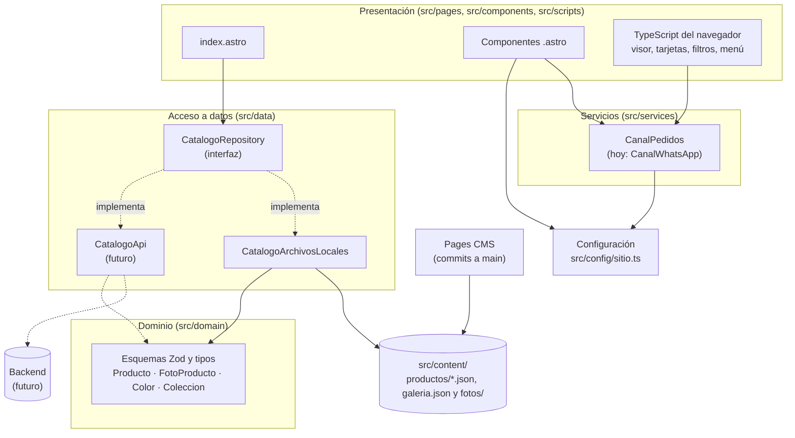

# Arquitectura de aalcuadrado

## Resumen

Sitio **100 % estático** hecho con **Astro + TypeScript (modo estricto)**. Al compilar, Astro lee los JSON de productos, optimiza las fotos y genera un solo `index.html` con todo lo necesario. El navegador no llama a ninguna API: los productos y las fotos que se administran desde el panel de [back-aalcuadrado](https://github.com/AIMtonio/back-aalcuadrado) se descargan al compilar (ver *Productos y fotos desde la API*).



## Capas

| Capa | Carpeta | Qué hace | Regla |
| --- | --- | --- | --- |
| Dominio | `src/domain/` | Esquemas Zod (`ProductoJsonSchema`, `ColorSchema`…) y tipos (`Producto`, `FotoProducto`, `Color`, `Coleccion`). | Solo depende de `zod`. Es el contrato que respetará el backend. |
| Datos | `src/data/` | `CatalogoRepository` (interfaz) y `CatalogoArchivosLocales` (lee los JSON y las fotos de `src/content/` con `import.meta.glob`). `src/data/index.ts` decide qué implementación se usa. | Páginas y componentes **nunca** leen archivos: siempre pasan por `catalogo`. |
| Servicios | `src/services/pedidos.ts` | `CanalPedidos` arma los enlaces de compra. Hoy, `CanalWhatsApp`. | Sin APIs de Astro: se usa igual en el servidor y en el navegador. |
| Configuración | `src/config/sitio.ts` | WhatsApp, redes, temporada, precios, preguntas frecuentes. | Todo lo que cambia seguido vive aquí. |
| Presentación | `src/pages/`, `src/components/`, `src/scripts/` | Componentes `.astro` y TypeScript nativo para la interactividad. | Sin React, Vue ni Tailwind. |

## Decisiones

**¿Por qué Astro?**
- Genera HTML estático: carga rápido en celular y se hospeda gratis.
- `astro:assets` optimiza las fotos al compilar (AVIF/WebP, varios tamaños, `srcset`), sin servicios externos.
- Permite cambiar a renderizado híbrido o de servidor con un adaptador, sin reescribir componentes.
- Envía al navegador solo el JavaScript que se usa (aquí, unos 13 KB entre visor, tarjetas, filtros y menú).

**¿Por qué estático por ahora?**
El catálogo cambia pocas veces por semana y las compras se cierran por WhatsApp. Un sitio estático no tiene costos, no se cae y no necesita mantenimiento de servidor. Cada cambio en el repositorio vuelve a publicar el sitio.

**¿Por qué Pages CMS?**
Da un panel para subir fotos y editar productos desde el navegador sin agregar servidor ni base de datos: cada cambio es un commit en `main`, que el GitHub Action publica. Su configuración está en `.pages.yml`. Cada producto es un JSON plano en `src/content/productos/` y las fotos van a `src/content/fotos/`. Los JSON guardan la ruta de cada foto agrupada por color, así que el color de una foto ya no depende de su nombre.

**¿Por qué `import.meta.glob` y no `getCollection`?**
`import.meta.glob` importa todas las fotos de `src/content/fotos/` como `ImageMetadata`, y el catálogo cruza esas rutas con las que guardan los JSON. Los JSON se validan con los mismos esquemas Zod del dominio, que también aceptan los valores vacíos (`""` o `null`) que escribe Pages CMS. El script `npm run productos:validar` reutiliza esos esquemas y corre antes de cada publicación.

**Visor y enlaces profundos.**
Un único `<dialog>` sirve a todos los productos y a la galería. Al compilar se generan las versiones del visor (WebP en 640–1920 px y miniaturas) y viajan como JSON en la página. El estado vive en la URL (`#producto/<slug>/<n>`), así que un enlace compartido abre la misma foto y el botón "atrás" cierra el visor.

**Productos y fotos desde la API.**
`npm run api:sincronizar` (`scripts/sincronizar-api.mjs`) inicia sesión en [back-aalcuadrado](https://github.com/AIMtonio/back-aalcuadrado) con `API_URL`, `API_USUARIO` y `API_PASSWORD`, descarga las fotos a `src/content/fotos/api/` y escribe los productos y los datos de las fotos en `src/content/catalogo-api.json` (ambos fuera de git). Como las fotos quedan dentro de `src/content/fotos/`, `import.meta.glob` las importa y Astro las optimiza igual que las del repositorio. `CatalogoArchivosLocales` valida el archivo con `CatalogoApiJsonSchema`:

- **Con la API**, los productos son los de la API. Las fotos de cada producto son las que la API tenga de él; si todavía no tiene, se usan las del JSON del repositorio con el mismo slug. Igual con la galería.
- **Sin la API** (sin `API_URL`), todo sale de `src/content/` como antes.

El script `prebuild` lo ejecuta antes de cada `npm run build`, así que corre solo en Vercel, en GitHub Actions y en local. Las credenciales vienen de las variables del proyecto (Vercel) o de los *secrets* (GitHub Actions); si la API no responde, el build falla y no se publica nada.

Después de cambiar productos o fotos hay que compilar de nuevo. Con Vercel, el panel tiene un botón **Publicar sitio** que llama al Deploy Hook del proyecto (la API guarda su URL en `DEPLOY_HOOK_URL`). Con GitHub Pages, se vuelve a ejecutar el workflow. Contrato completo: `docs/integracion-front.md` del backend.

## Cómo migrar a un backend

1. **Crear `CatalogoApi`** en `src/data/CatalogoApi.ts` implementando `CatalogoRepository`. Debe validar las respuestas con los esquemas de `src/domain/` y devolver fotos con URL remota (en `FotoProducto.src`).
2. **Cambiar una línea** en `src/data/index.ts`:
   ```ts
   export const catalogo: CatalogoRepository = new CatalogoApi(import.meta.env.API_URL);
   ```
3. **Fotos remotas:** agregar el dominio de las imágenes a `image.remotePatterns` en `astro.config.mjs` para que Astro las siga optimizando.
4. **Elegir el modo de renderizado:**
   - *Sigue estático:* se compila con los datos de la API en ese momento; el backend dispara un nuevo despliegue (webhook a GitHub Actions) cuando cambia el catálogo.
   - *Híbrido o de servidor:* instalar un adaptador (`npx astro add node`, `netlify`, `cloudflare` o `vercel`) y marcar con `export const prerender = false` solo las rutas que deban ser dinámicas (por ejemplo, inventario en tiempo real o `/pedido`). El resto se queda prerenderizado.
5. **Carrito o checkout:** crear otra implementación de `CanalPedidos` (por ejemplo, `CanalCarrito`) y cambiarla en `src/services/pedidos.ts`. Los botones de la UI ya piden enlaces a la interfaz, no a WhatsApp.
