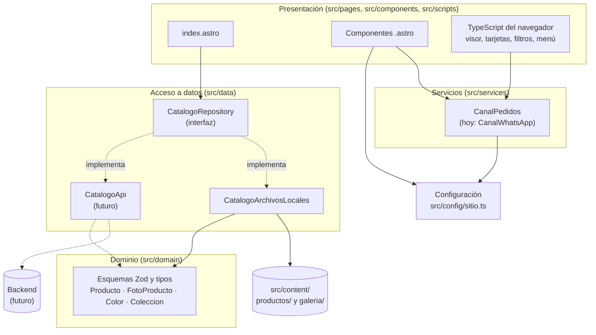

# Arquitectura de aalcuadrado

## Resumen

Sitio **100 % estático** hecho con **Astro + TypeScript (modo estricto)**. Al compilar, Astro lee las carpetas de productos, optimiza las fotos y genera un solo `index.html` con todo lo necesario. No hay servidor, base de datos ni API.



## Capas

| Capa | Carpeta | Qué hace | Regla |
| --- | --- | --- | --- |
| Dominio | `src/domain/` | Esquemas Zod (`ProductoJsonSchema`, `ColorSchema`…) y tipos (`Producto`, `FotoProducto`, `Color`, `Coleccion`). | Solo depende de `zod`. Es el contrato que respetará el backend. |
| Datos | `src/data/` | `CatalogoRepository` (interfaz) y `CatalogoArchivosLocales` (lee carpetas con `import.meta.glob`). `src/data/index.ts` decide qué implementación se usa. | Páginas y componentes **nunca** leen archivos: siempre pasan por `catalogo`. |
| Servicios | `src/services/pedidos.ts` | `CanalPedidos` arma los enlaces de compra. Hoy, `CanalWhatsApp`. | Sin APIs de Astro: se usa igual en el servidor y en el navegador. |
| Configuración | `src/config/sitio.ts` | WhatsApp, redes, temporada, precios, preguntas frecuentes. | Todo lo que cambia seguido vive aquí. |
| Presentación | `src/pages/`, `src/components/`, `src/scripts/` | Componentes `.astro` y TypeScript nativo para la interactividad. | Sin React, Vue ni Tailwind. |

## Decisiones

**¿Por qué Astro?**
- Genera HTML estático: carga rápido en celular y se hospeda gratis.
- `astro:assets` optimiza las fotos al compilar (AVIF/WebP, varios tamaños, `srcset`), sin servicios externos.
- Permite cambiar a renderizado híbrido o de servidor con un adaptador, sin reescribir componentes.
- Envía al navegador solo el JavaScript que se usa (aquí, unos 13 KB entre visor, tarjetas, filtros y menú).

**¿Por qué estático por ahora?**
El catálogo cambia pocas veces por semana y las compras se cierran por WhatsApp. Un sitio estático no tiene costos, no se cae y no necesita mantenimiento de servidor. Cada cambio en el repositorio vuelve a publicar el sitio.

**¿Por qué `import.meta.glob` y no `getCollection`?**
Las fotos viven sueltas dentro de cada carpeta y se identifican por su nombre (`portada`, `morado-01`…). `import.meta.glob` las importa como `ImageMetadata` sin declarar cada una, y la validación de `producto.json` usa los mismos esquemas Zod del dominio. El script `npm run productos:validar` reutiliza esos esquemas.

**Visor y enlaces profundos.**
Un único `<dialog>` sirve a todos los productos y a la galería. Al compilar se generan las versiones del visor (WebP en 640–1920 px y miniaturas) y viajan como JSON en la página. El estado vive en la URL (`#producto/<slug>/<n>`), así que un enlace compartido abre la misma foto y el botón "atrás" cierra el visor.

## Cómo migrar a un backend

1. **Crear `CatalogoApi`** en `src/data/CatalogoApi.ts` implementando `CatalogoRepository`. Debe validar las respuestas con los esquemas de `src/domain/` y devolver fotos con URL remota (en `FotoProducto.src`).
2. **Cambiar una línea** en `src/data/index.ts`:
   ```ts
   export const catalogo: CatalogoRepository = new CatalogoApi(import.meta.env.API_URL);
   ```
3. **Fotos remotas:** agregar el dominio de las imágenes a `image.remotePatterns` en `astro.config.mjs` para que Astro las siga optimizando.
4. **Elegir el modo de renderizado:**
   - *Sigue estático:* se compila con los datos de la API en ese momento; el backend dispara un nuevo despliegue (webhook a GitHub Actions) cuando cambia el catálogo.
   - *Híbrido o de servidor:* instalar un adaptador (`npx astro add node`, `netlify`, `cloudflare` o `vercel`) y marcar con `export const prerender = false` solo las rutas que deban ser dinámicas (por ejemplo, inventario en tiempo real o `/pedido`). El resto se queda prerenderizado.
5. **Carrito o checkout:** crear otra implementación de `CanalPedidos` (por ejemplo, `CanalCarrito`) y cambiarla en `src/services/pedidos.ts`. Los botones de la UI ya piden enlaces a la interfaz, no a WhatsApp.
